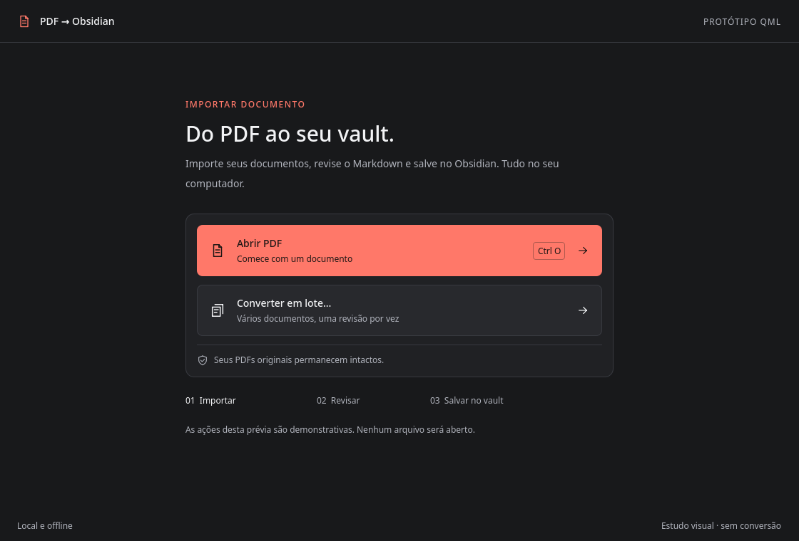

# Protótipo isolado de importação — Qt Quick/QML

Estudo visual inspirado no Raycast: fundo quase preto, superfícies em cinza, destaque neutro, fontes Geist locais, hierarquia tipográfica e ações compactas. Este executável continua demonstrativo. A aplicação principal já usa os mesmos componentes para importação e progresso reais.



## Executar

A partir da raiz do projeto, com o ambiente existente:

```bash
.venv/bin/python prototypes/qml_import/run.py
```

Se necessário, selecionar explicitamente o renderizador por software:

```bash
.venv/bin/python prototypes/qml_import/run.py --software
```

A aplicação de produção continua sendo iniciada por `.venv/bin/pdf-obsidian`.

## O que é demonstrado

- Tela de importação em uma janela Qt Quick independente, com Qt Quick Controls Basic.
- `src/pdf_obsidian/qml/ImportPage.qml` e seus componentes são compartilhados com a aplicação. `Main.qml` é somente a janela demonstrativa; `Theme.qml` define cores, espaçamento, raios e tipografia.
- `ImportAction.qml`: ação reutilizável, com foco visível, hover de 100 ms, pressionado e desabilitado.
- `Icon.qml`: vetores locais de traço uniforme, sem fontes, imagens externas ou recursos remotos.
- Mouse, Tab/Shift+Tab, Espaço e Ctrl+O; nomes e descrições acessíveis dos botões.
- Layout central com largura máxima, quebra de texto e rolagem quando a janela não comporta o conteúdo.
- Comunicação demonstrativa `importRequested(mode)` → slot Python → sinal de mensagem → propriedade QML. O controlador aceita apenas os modos `single` e `batch` e não acessa arquivos.

**Abrir PDF** e **Converter em lote…** apenas exibem mensagens. Não há seletor de arquivos, conversão, worker, progresso simulado, editor, exportação ou persistência. O protótipo compartilha a identidade Monochrome Premium descrita em [DESIGN_SYSTEM.md](../../DESIGN_SYSTEM.md).

A criação original deste protótipo restringiu-se a esta pasta. Nas etapas seguintes, autorizadas pelo usuário, a coordenação Python foi extraída e a tela de importação QML foi integrada à aplicação principal. O protótipo continua demonstrativo; seus componentes visuais foram movidos para o pacote da aplicação e são reutilizados aqui. Consulte o estado atual em [MIGRATION.md](MIGRATION.md). Nenhum PDF pessoal ou vault foi utilizado.

## Verificar e gerar capturas

```bash
.venv/bin/python prototypes/qml_import/run.py --check
.venv/bin/python prototypes/qml_import/run.py --check --size 640x600 --text-scale 1.25
.venv/bin/pyside6-qmllint src/pdf_obsidian/qml/ImportPage.qml src/pdf_obsidian/qml/components/Theme.qml src/pdf_obsidian/qml/components/ImportAction.qml src/pdf_obsidian/qml/components/Icon.qml prototypes/qml_import/Main.qml
.venv/bin/python prototypes/qml_import/run.py --capture /tmp/qml-import.png
.venv/bin/python prototypes/qml_import/run.py --capture /tmp/qml-import-compact.png --size 640x600 --text-scale 1.25
```

`--capture` e `--check` selecionam explicitamente plataforma offscreen e renderização por software apenas neste processo. A execução normal usa o ambiente desktop. `--text-scale` é um multiplicador de validação das fontes do protótipo, não uma preferência persistida.

A checagem carrega a cena e verifica Tab, Espaço, Ctrl+O, clique, desabilitado e mensagens da ponte Python, falhando em caso de avisos QML. Não mede desempenho de GPU, acessibilidade com leitor de tela ou comportamento em Wayland/X11 reais.

A [captura compacta](preview-compact.png) usa 640 × 600 e texto ampliado em 25%. Em alturas pequenas o conteúdo central pode rolar; cabeçalho e rodapé permanecem disponíveis.

Validação da entrega original do protótipo: **230 testes existentes passaram em 49,85 s**; hashes de **46 arquivos preexistentes** conferidos, sem alterações nessa entrega. Os registros detalhados das etapas posteriores são mantidos no checkout de desenvolvimento.

A avaliação técnica e o plano estão em [MIGRATION.md](MIGRATION.md).
